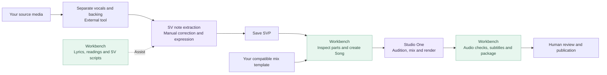

<div align="center">


# CoverWorkbench

**Less repetition. More music.**

A local cover-production workbench for Synthesizer V and Studio One.<br>
Bring lyric preparation, repetitive tasks, mix-session setup and delivery into one place.

[简体中文](README.md) · **English**

[](https://github.com/FeiyangHong/CoverWorkbench/actions/workflows/ci.yml)
[](LICENSE)
[](https://www.python.org/downloads/windows/)

[Quick start](#quick-start) · [Preview](#preview) · [Deployment](docs/Deployment.md) · [Contributing](CONTRIBUTING.md)

</div>

## What it helps with

CoverWorkbench handles repeatable preparation and delivery tasks while detailed lyric, note, pronunciation and voice editing stays in SV. The website is a local control panel: normal use requires no cloud account, Codex or Node.js. **The application UI is currently Chinese.**

| Stage | What the workbench provides | What you decide |
| --- | --- | --- |
| Project preparation | Import a saved SVP into an original snapshot and a separate work copy | Song, language and source version |
| Lyrics and subtitles | Import local lyrics or explicitly search, prepare optional Japanese romaji and subtitle drafts | Lyrics, readings, translation and timing |
| Repetitive SV tasks | Native scripts for phrase lyrics, phrase reuse and group-level base voice presets | Pitch, rhythm, voice bank and expressive details |
| Studio One setup | Build an independent Song from a compatible local template, mapping vocal outputs and preserving effects and routing | Template choice and mix adjustments for the new song |
| Checks and delivery | Use local FFmpeg for audio checks, delivery packages and video audio replacement | Final listening, visuals and publication |

## Preview

### Workflow desk: prepare materials, focus on music, organize delivery


### Studio One: inspect parts, assign roles, then choose your own template


> Screenshots use an isolated, fictional **Moonlit Demo** project containing only programmatically generated `la` notes. Paths are normalized to generic examples. No real songs, personal settings or commercial plugin presets are included. These are actual UI and track-inspection results; no native synthesis or Song generation was performed. A fresh installation needs your own compatible template.

<details>
<summary>Three desktop icons for your workspace</summary>

| Signature | Vocal | Studio |
| :---: | :---: | :---: |
|  |  |  |

Select and apply an icon from **桌面图标 / Desktop icons** in the app. Windows ICO versions are included in the repository.

</details>

## Workflow



Already have a finished SVP? Start with the Studio One builder; there is no need to repeat extraction or correction.

## Quick start

Native integrations target **Windows** and require **Python 3.11+**. The clone command below also requires Git. Alternatively, download the source ZIP from GitHub, extract it and run the setup script.

```powershell
git clone https://github.com/FeiyangHong/CoverWorkbench.git
cd CoverWorkbench
.\Setup.ps1
.\Start.ps1
```

Open <http://127.0.0.1:8765/>:

1. Use **环境设置 / Environment settings** to select local tools, your Songs directory and your own mix templates.
2. Use **导入工程 / Import project** to select a saved SVP, title and language. You can also use the Studio One builder directly.
3. Open the work copy in SV, edit and save before reading it from the workbench. After rendering, use the checks and delivery tools.

Setup creates an isolated `.venv` and an empty workspace without modifying SV, Studio One or MSST. Japanese readings and romaji are optional:

```powershell
.\Setup.ps1 -WithLyrics
```

SV scripts must be installed separately into the editor's script directory and rescanned. See **[Deployment](docs/Deployment.md)** for tool configuration, scripts, template requirements, alternatives when PowerShell scripts are blocked, and migration.

## Before you start

- **Bring your own software and materials.** Songs, lyric libraries, voice banks, model weights, commercial plugins and captured plugin presets are not bundled. Install FFmpeg/FFprobe yourself. Online lyric searches send requests to the provider.
- **Studio One templates have structural requirements.** The builder supports compatible Studio One 7 templates, constant tempo, a single meter and 1–16 vocal outputs. Multiple leads and songs without harmony are supported; the template itself still needs a harmony recipe. Arbitrary Song layouts are not guaranteed to work.
- **SV2 needs additional local host state.** Configure your own SV2 host in Environment settings before generating SV2 Songs on a fresh installation. See the [Studio One integration guide](integrations/studio-one/README.md).
- **Assisted results need human review.** Pitch comparisons provide diagnostic clues, not correctness scores. Lyrics, alignment, pronunciation and mix quality need checking. Experimental GAME/WhisperX scripts and models are outside the portable distribution.
- **Trusted local use only.** Do not expose the server publicly or use it as a multi-user service. See [SECURITY.md](SECURITY.md).

## Files and privacy

Source code is managed separately from creative work. Git ignores local settings, project indexes, song copies, lyrics, reports, models and runtime environments; back these up separately. On another computer, reinstall dependencies, register templates and re-import materials. Existing absolute references are not automatically migrated.

| Directory | Contents |
| --- | --- |
| `app/` | Local service and web interface |
| `integrations/sv/` | Installable SV script sources |
| `tools/`, `tests/` | Setup, release checks and validation tools |
| `docs/`, `assets/` | Documentation, demo screenshots and product icons |
| `config/` | Public example configuration; personal settings are ignored |
| `projects/`, `data/`, `runtime/` | Local creative and runtime data, excluded from Git |

## Contributing

Read [CONTRIBUTING](CONTRIBUTING.md) and the [Git workflow](docs/GitWorkflow.md). Commit titles use English, for example `[FEAT]: Add ...`, `[FIX]: Correct ...` and `[DOCS]: Update ...`. Run `tools/SetupGit.ps1` in each clone to install the conventions.

```powershell
python tests/portable-smoke.py
python tests/git-conventions.py
python tools/release_check.py
```

CI uses Windows, Python 3.11/3.13 and synthetic fixtures to exercise clean installation and browser flows. Native synthesis quality and third-party plugins require separate checks. The badge above links to live run records.

To refresh UI screenshots without personal projects, follow the [isolated capture instructions](docs/images/README.md).

## License

CoverWorkbench's original source, documentation and product icons use the **[MIT License](LICENSE)**. Commercial use and proprietary modifications are permitted, subject to retaining the copyright and license notice. Third-party components, music, voice banks and user materials retain their own terms; see the [license policy](docs/Licensing.md) and [third-party notices](THIRD_PARTY_NOTICES.md).
