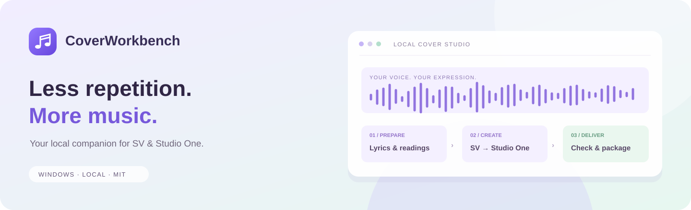
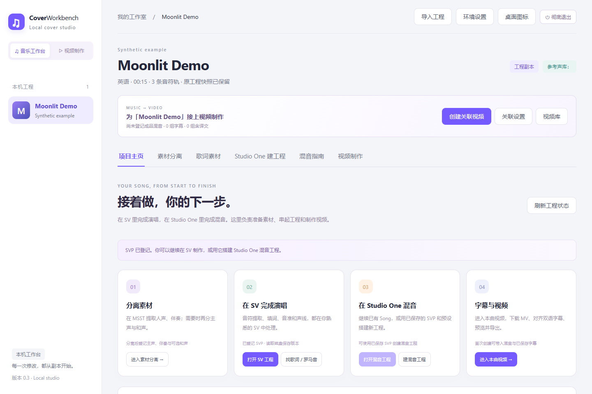
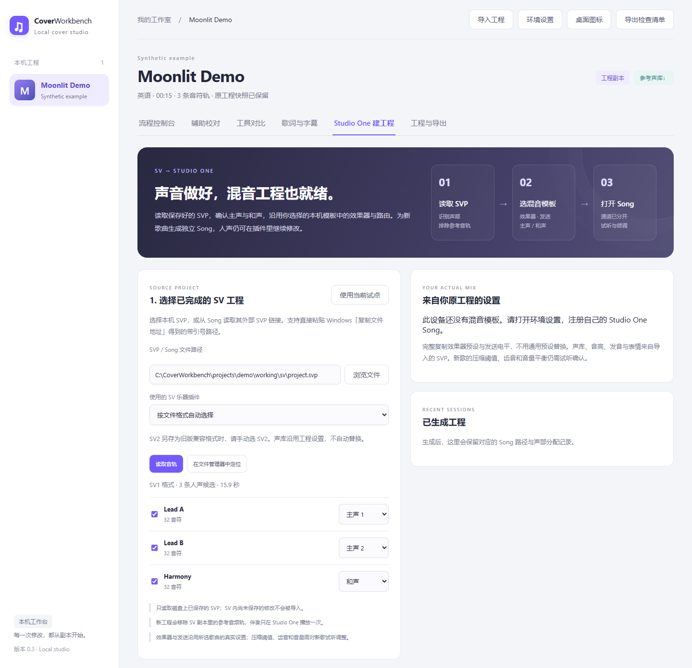
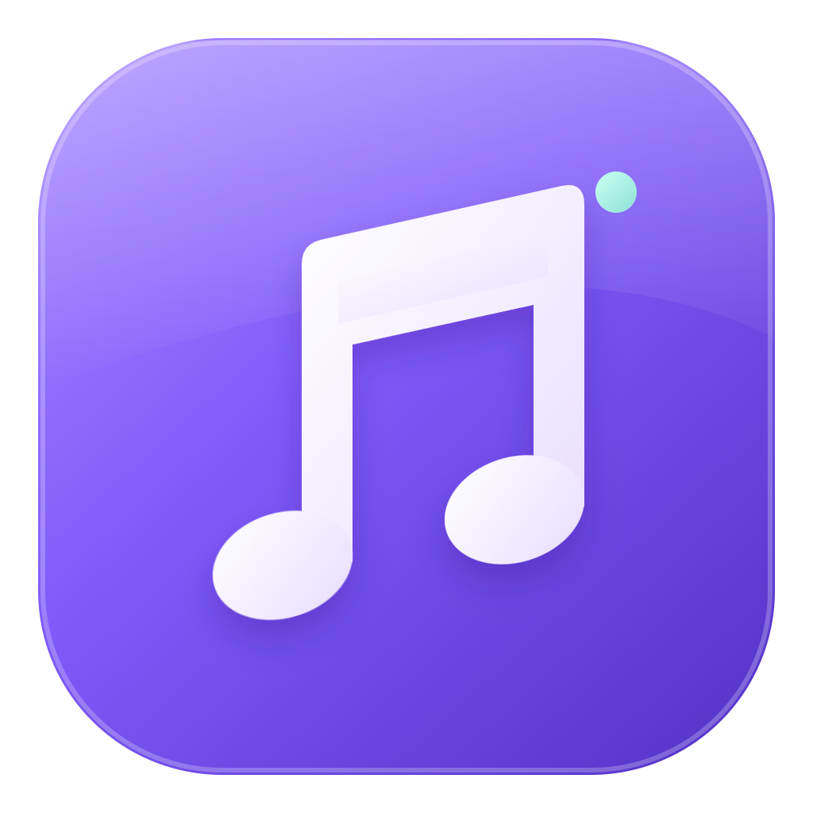
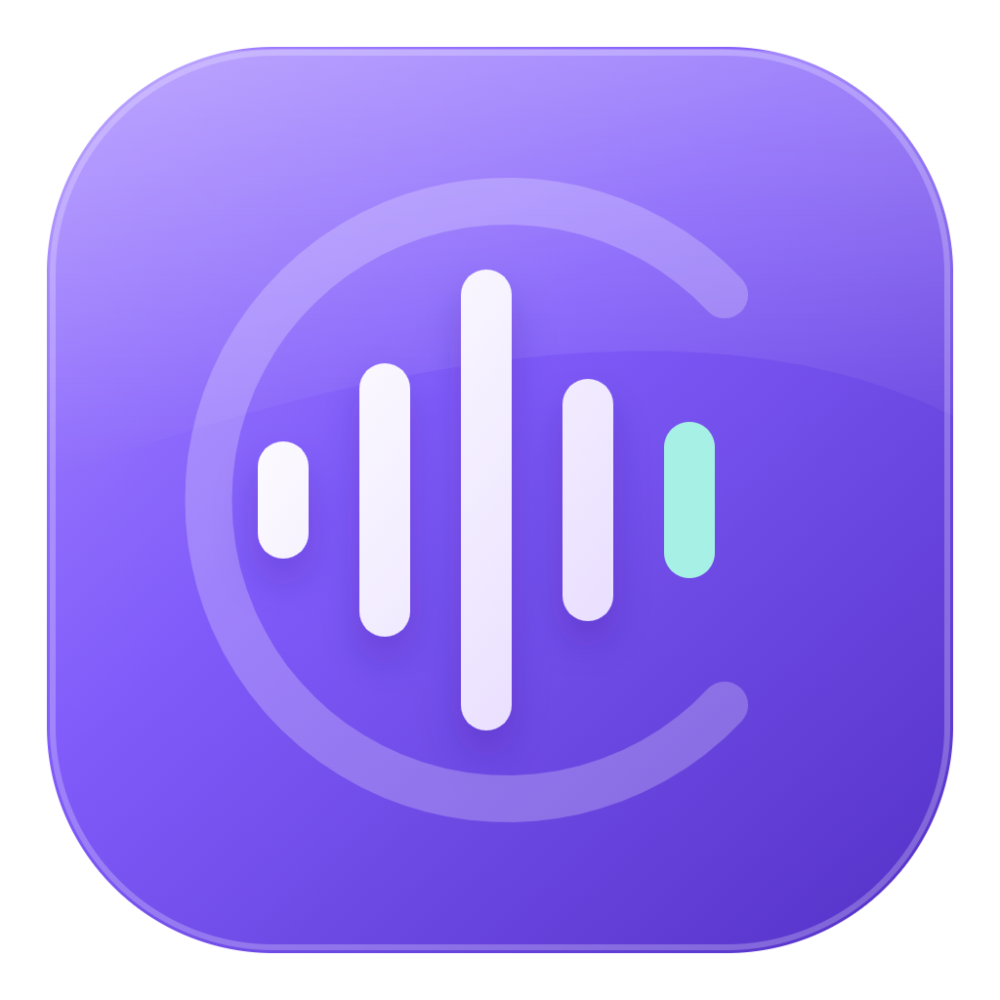
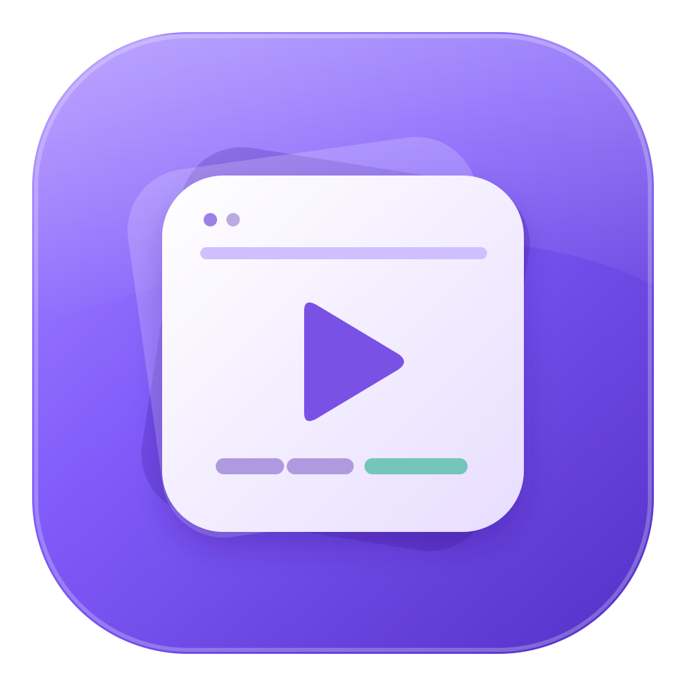
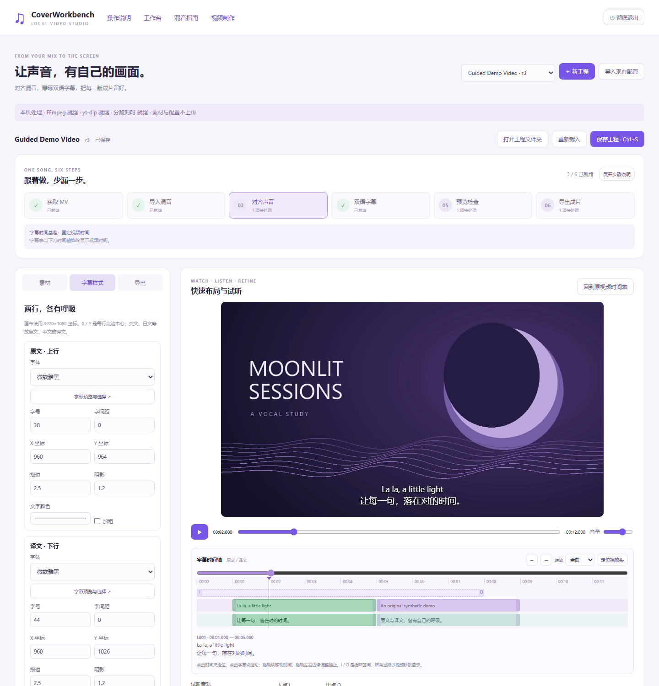
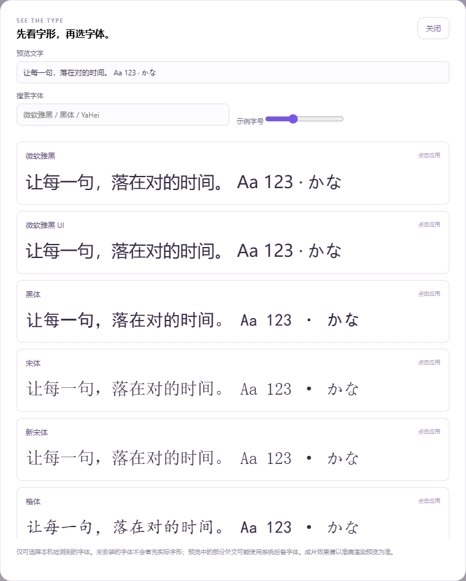
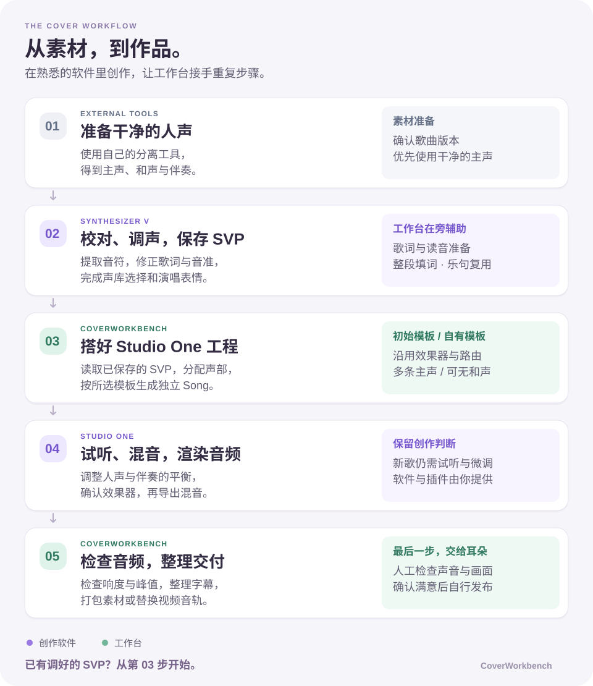

<div align="center">



# CoverWorkbench

**把时间，留给声音。**

面向 Synthesizer V 与 Studio One 的本地翻唱工作台。<br>
歌词准备、重复操作、混音工程搭建与交付整理，放在一个地方。

**简体中文** · [English](README.en.md)

[](https://github.com/FeiyangHong/CoverWorkbench/actions/workflows/ci.yml)
[](LICENSE)
[](https://www.python.org/downloads/windows/)

[快速开始](#快速开始) · [界面预览](#界面预览) · [部署指南](docs/Deployment.md)

</div>

## 它能帮你做什么

CoverWorkbench 把适合批量处理的步骤交给工具，让歌词、音符、发音和声线的精细调整继续留在你熟悉的 SV 中。网站是本机控制台，普通使用无需云端账号、Codex 或 Node.js；目前界面为中文。

| 环节 | 工作台提供的能力 | 仍由你决定 |
| --- | --- | --- |
| 工程准备 | 导入已保存的 SVP，建立原始快照与独立工作副本 | 曲目、语言与素材版本 |
| 歌词与字幕 | 导入本地歌词或主动搜索，生成可选日语罗马音与字幕草稿 | 歌词、读音、翻译与时间轴校正 |
| 制作导航 | 项目主页集中登记 SVP、Song、主声、伴奏与混音，一键打开对应原生工程 | 音符、歌词、音准、声库与表情都在 SV 中完成 |
| 素材分离 | 连接本机 MSST，按需启动、跳转或嵌入，登记分离结果供后续步骤使用 | 模型选择、分离结果试听 |
| Studio One 建工程 | 从兼容的本机模板生成独立 Song，分配人声输出并复用效果器与路由 | 模板选择与新曲的混音微调 |
| 混音学习 | 按问题定位旋钮，清晰控件图与实拍局部对照，混响／回声／EQ 前后试听 | 在 Studio One 中试听与调整 |
| 视频制作 | [歌曲与视频关联、自动带入混音与双语字幕、SV 时间锚点、准确预览与独立版本导出](docs/VideoStudio.md) | 对时与翻译确认、最终画面和试听 |
| 检查与交付 | 通过本机 FFmpeg 检查音频、整理交付包、替换视频音轨 | 最终试听、画面与发布 |

## 界面预览

### 项目主页：从素材到视频，在一个地方接着做



### Studio One：读取声部，确认角色，选择初始混音模板



> 截图来自隔离环境中的虚构 **Moonlit Demo** 工程，仅含程序生成的 `la` 音符。路径已替换为通用示例；不包含真实歌曲或私人配置。截图展示实际网页和音轨读取结果，未执行原生合成或生成 Song；新设备已提供两套初始模板，仍需安装对应的正版插件。

<details>
<summary>三种桌面图标，选择你的工作台标记</summary>

| Signature | Vocal | Studio |
| :---: | :---: | :---: |
|  |  |  |

在网页的「桌面图标」中选择并应用。仓库包含对应的 Windows ICO 文件。

</details>

### 视频制作：在画面里打磨双语字幕



> 视频截图使用程序生成的画面与测试音调，仅展示虚构工程的快速布局。准确预览和正式导出使用本机 FFmpeg/libass，原素材与每版成片分别保留。详见[视频制作指南](docs/VideoStudio.md)。

<details>
<summary>字体预览：用中文名称找字体，先看字形再应用</summary>



支持自定义示例文字、搜索与示例字号；未安装字体明确标注。视频制作页同时提供六步缺项检查、偏移来源记录和可缩放的双语字幕时间轴。

</details>

## 工作流程



已有调好的 SVP？直接从「Studio One 建工程」开始，无需重走提取与校对。

## 快速开始

支持的本机集成环境为 **Windows**，需要 **Python 3.11+**。

```powershell
git clone https://github.com/FeiyangHong/CoverWorkbench.git
cd CoverWorkbench
.\Setup.ps1
.\Start.ps1
```

打开 <http://127.0.0.1:8765/>：

用完后可在网页右上角点 **⏻ 彻底退出**，停止本机后台；正在处理任务时会提示等待。下次双击桌面快捷方式或运行 `Start.vbs` 重新启动。

1. 在 **环境设置** 中选择本机工具、Songs 目录。Studio One 页面可直接选择随附的初始模板，也可注册自己的混音模板。
2. 在 **导入工程** 中选择已保存的 SVP，填写标题与语言。也可直接使用 Studio One 建工程页。
3. 在 **项目主页** 选择下一步：分离素材、打开 SV、继续已有 Song 或进入本曲视频。用 **管理文件路径** 登记主声、伴奏与成品混音，后续步骤自动读取。

**素材分离** 页可设置自己的 MSST 启动程序 / 快捷方式与本机网页地址；点击才启动，不随工作台自动加载模型。支持新标签页和可选页内嵌入，分离仍由独立 MSST 服务执行。MSST 未安装或页面限制嵌入时，可继续使用已有本地素材。详见 [制作主页与 MSST 接入](docs/Production.md)。

歌词素材页负责搜词、导入与罗马音准备；正式双语字幕在视频区调整。旧的音符校对、模型对比、网页 SV 遥控与字幕草稿默认隐藏，可在项目主页 **更多工具与历史功能** 中显式启用。正常流程不轮询 SV 实时连接。

安装会创建独立 `.venv` 和空白工作区，不会修改 SV、Studio One 或 MSST。日语读音与罗马音依赖可按需安装：

```powershell
.\Setup.ps1 -WithLyrics
```

SV 脚本需要另外安装到对应编辑器的脚本目录并重新扫描。工具配置、脚本安装、模板要求、PowerShell 启动替代方法和换机说明见 **[部署指南](docs/Deployment.md)**。

混音时可打开工作台的 **「混音指南」**，按声音问题查找旋钮；安装可选引擎后，可用本机真实 **FabFilter** 生成 A/B。支持单插件试调，也可读取已保存 Studio One 工程的预设、发送与总线，映射自己的干人声和伴奏，对比原设置与参数修改。工程模式是静态重建，兼容范围与验证限制见 [指南说明](docs/MixingGuide.md)。也保留无需插件的浏览器教学示例。

## 初始混音模板

新安装即可在「Studio One 建工程」中选择，无需先准备自己的 Song：

| 模板 | 混音结构 |
| --- | --- |
| **Studio Vocal Plate** | 三组主声处理、和声、Plate 混响与延迟发送，统一汇入人声总线 |
| **Studio Vocal Delay** | 主声与和声处理、Plate 混响及独立延迟返回；延迟返回默认静音，按需启用 |

两套模板均保留作者实际使用的 EQ、压缩、齿音、发送电平与路由，已移除歌曲内容、歌词、声库选择、个人路径与设备信息。导入新 SVP 后，声库与演唱内容来自你自己的工程。

需要自行安装 **Synthesizer V Studio Pro** 和 **FabFilter Pro-Q 3、Pro-C 2、Pro-DS、Pro-R 2、Timeless 3**。使用 SV2 时，仍需在环境设置配置本机 SV2 宿主。新曲的音量与效果参数请试听后微调。详见 [模板说明](assets/studio-one/README.md)。

## 使用前了解

- **软件与素材由你提供。** 仓库不附带歌曲、歌词库、声库、模型权重、商业插件程序。随附混音模板只包含清理后的效果器参数与路由。FFmpeg／FFprobe 需要自行安装；在线搜词会向提供方发送搜索请求。
- **Studio One 模板有结构要求。** 当前支持兼容的 Studio One 7 模板、固定速度与单一拍号、1–16 路人声，可有多条主声，也可没有和声。模板本身仍需包含和声处理配置；任意 Song 布局不保证兼容。
- **SV2 需要额外的本机宿主状态。** 新设备须在环境设置中配置自己的 SV2 宿主，之后才能生成 SV2 Song。详见 [Studio One 集成说明](integrations/studio-one/README.md)。
- **辅助结果需要试听确认。** 音高对比只提供排查线索；歌词、对齐、发音和混音没有自动正确性保证。GAME／WhisperX 实验脚本及模型不在便携发行范围内。
- **仅供可信的本机使用。** 不要将服务端口暴露到公网或作为多人服务。安全边界见 [SECURITY.md](SECURITY.md)。

## 文件与隐私

源码和创作数据分开管理。Git 忽略本地设置、工程索引、歌曲副本、歌词、报告、模型与运行环境；这些内容需要你另外备份。换机时应重新安装依赖、选择初始模板或注册自有模板，并导入素材；已有绝对路径不会自动迁移。

| 目录 | 内容 |
| --- | --- |
| `app/` | 本机服务与网页界面 |
| `integrations/sv/` | 可安装的 SV 脚本源文件 |
| `tools/`、`tests/` | 安装、发布检查与验证工具 |
| `docs/`、`assets/` | 文档、示例截图与产品图标 |
| `config/` | 公开示例配置；个人配置被忽略 |
| `projects/`、`data/`、`runtime/` | 本机创作与运行数据，不上传 Git |

## 致谢

感谢这些项目及其维护者，让工作台可以串起已有的制作工具：

- [MSST-WebUI](https://github.com/SUC-DriverOld/MSST-WebUI) 与 [Music-Source-Separation-Training](https://github.com/ZFTurbo/Music-Source-Separation-Training)：独立素材分离服务。
- [FFmpeg / FFprobe](https://ffmpeg.org/)、[libass](https://github.com/libass/libass) 与 [yt-dlp](https://github.com/yt-dlp/yt-dlp)：媒体处理、字幕排版和可选视频下载。
- [pykakasi](https://github.com/miurahr/pykakasi)、[Pedalboard](https://github.com/spotify/pedalboard) 与 [Playwright](https://playwright.dev/)：可选日语读音、原生插件试听和开发验证。

原生创作与混音使用用户自行安装的 [Synthesizer V / Dreamtonics](https://www.dreamtonics.com/synthesizerv/)、[Studio One / Fender Studio](https://www.fender.com/pages/fender-studio-pro) 和 [FabFilter](https://www.fabfilter.com/)。以上项目与产品均有各自维护者与条款；致谢不代表官方合作，仓库不附带它们的软件、模型或授权。详见 [第三方声明](THIRD_PARTY_NOTICES.md)。

## 许可证

CoverWorkbench 的原创代码、文档与产品图标采用 **[MIT License](LICENSE)**，允许商业使用及闭源修改，但须保留版权与许可声明。第三方组件、音乐、声库及用户素材遵循各自条款，见 [许可说明](docs/Licensing.md) 与 [第三方声明](THIRD_PARTY_NOTICES.md)。
